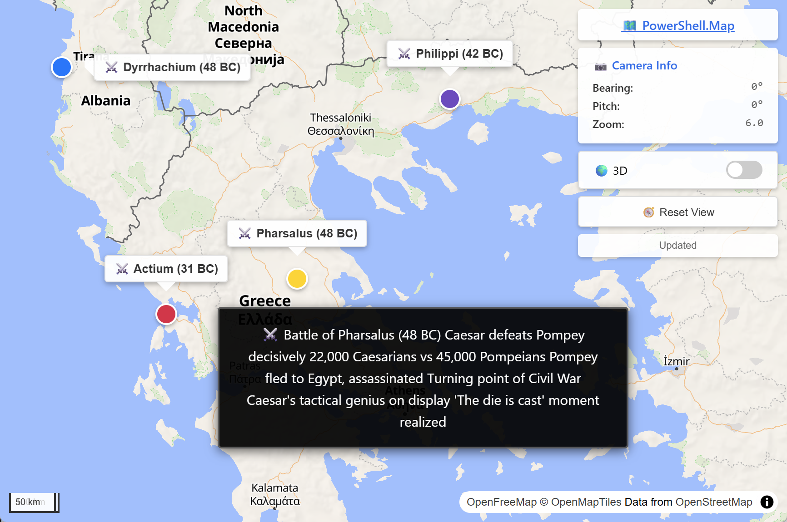
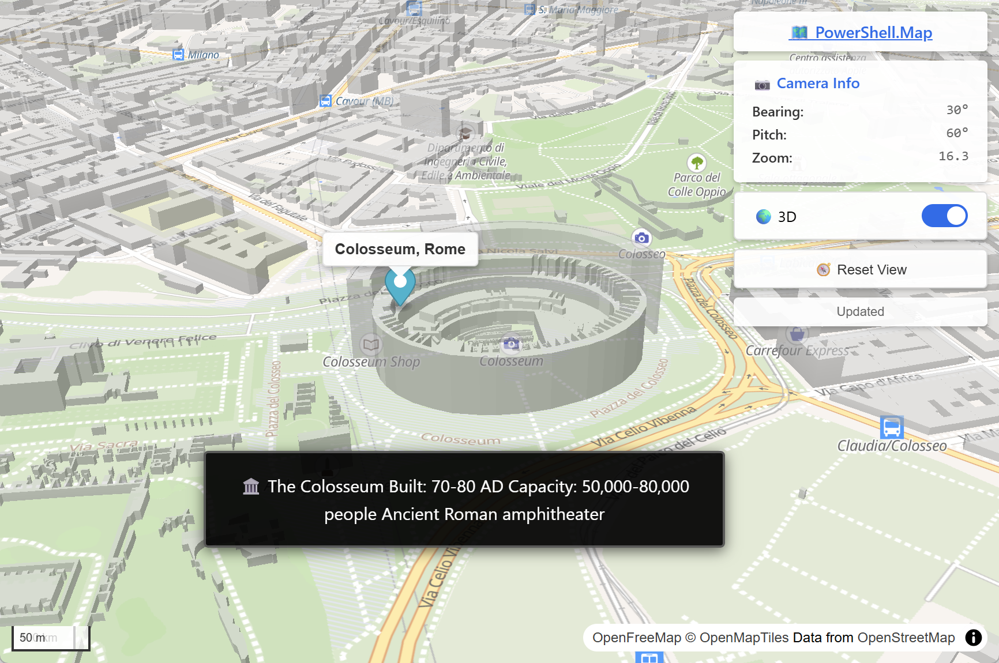

# PowerShell.MCP

[](https://github.com/PowerShell/PowerShell)
[](#prerequisites)
[](https://www.powershellgallery.com/packages/PowerShell.MCP)
[](https://www.powershellgallery.com/packages/PowerShell.MCP)
[](https://opensource.org/licenses/MIT)

**Security Warning:** This module provides complete PowerShell access to your system. Malicious use could result in severe damage. Use responsibly and only in trusted environments.

## Overview

*The universal MCP server—one installation gives AI access to 10,000+ PowerShell modules and any CLI tool.*

PowerShell.MCP connects AI assistants to the entire PowerShell ecosystem through a single MCP server. You and AI collaborate in the same PowerShell console—every command the AI runs appears there as it runs, and a transcript can record all of it (see [Auditing an AI Session](SECURITY.md#auditing-an-ai-session)).

<div align="center">
  
</div>

**Need bash, a language REPL, a SQL console, or a debugger instead?** If you can't install PowerShell 7, or you'd rather drive another shell (bash, cmd, zsh), a language REPL (python, node, racket, lua, …), a SQL console (sqlite3, …), or a language debugger (pdb, jdb, perldb), check out **[ripple](https://github.com/yotsuda/ripple)** — the same shared-console concept generalized to any REPL, with unified ConPTY-based consoles running side by side.

## Why PowerShell.MCP?

**A universal gateway to the PowerShell ecosystem.**

PowerShell.MCP takes a different approach from service-specific MCP servers. Rather than providing curated tools for individual services, it gives AI assistants direct access to PowerShell—letting them use the same modules and CLI tools that professionals use every day.

This means:
- **One MCP server replaces many** — no need for separate servers for each service
- **Immediate access** to 10,000+ modules on [PowerShell Gallery](https://www.powershellgallery.com/) without waiting for dedicated MCP servers
- **Cross-service workflows** combining multiple services in a single pipeline
- **API exploration** — prototype and verify API behavior with immediate feedback before writing production code
- **Self-evolving capabilities** — AI writes PowerShell scripts that both AI and users can execute, continuously extending what's possible
- **Industry-standard skills** — commands you learn transfer directly to your own work

**Examples: PowerShell pipeline processing**

*"Show me bug issues from the PowerShell repo with their authors"*

```powershell
gh issue list --repo PowerShell/PowerShell --json title,author,labels |
    ConvertFrom-Json |
    Where-Object { $_.labels.name -contains "Issue-Bug" } |
    Select-Object title, @{N='by';E={$_.author.login}}
```

*"List my running Azure VMs with their sizes"*

```powershell
Get-AzVM -Status | Where-Object PowerState -eq "VM running" |
    Select-Object Name, @{N='Size';E={$_.HardwareProfile.VmSize}}, Location
```

*"Check if GitHub's API returns rate limit info"*

```powershell
Invoke-RestMethod https://api.github.com/rate_limit |
    Select-Object -ExpandProperty rate
```

*"Get the current user's Windows username via Win32 API"*

```powershell
Add-Type -MemberDefinition '[DllImport("advapi32.dll")] public static extern bool GetUserName(System.Text.StringBuilder sb, ref int len);' -Name Win32 -Namespace API
$sb = [System.Text.StringBuilder]::new(256); $len = 256
[API.Win32]::GetUserName($sb, [ref]$len); $sb.ToString()
```

PowerShell.MCP complements your existing MCP setup by providing a flexible, general-purpose foundation.

## What Makes It Powerful

**🖥️ Multi-Client Architecture**
- Each client instance gets its own exclusive console—run multiple Claude Code sessions in parallel
- Safe parallel operation with no resource conflicts
- Unique window titles (e.g., "#12345 Taxi") for easy identification
- `Get-MCPOwner` cmdlet shows which client owns the current console

**🤝 Shared Console Experience**
- You and AI collaborate in the same PowerShell session with full transparency
- Every command AI executes appears in your console in real-time
- You can respond to interactive prompts directly in the console
- Short commands are added to the console history on Windows—learn by watching AI work

**🔄 Persistent Session State**
- Authenticate once, stay authenticated: Azure, AWS, Microsoft 365, and more
- Modules, variables, and functions persist across commands
- No re-initialization overhead

**🌐 Universal Access**
- [PowerShell Gallery](https://www.powershellgallery.com/): 10,000+ modules including [Az](https://www.powershellgallery.com/packages/Az), [AWS.Tools](https://www.powershellgallery.com/packages/AWS.Tools.Common), [Microsoft.Graph](https://www.powershellgallery.com/packages/Microsoft.Graph)
- Any CLI tool: git, docker, kubectl, terraform, gh, az cli, aws cli
- AI learns syntax automatically via `Get-Help`

**🔗 Pipeline Composability**
- Describe what you want in natural language—AI constructs the optimal pipeline
- "Top 5 largest logs" → `Get-ChildItem *.log | Sort-Object Length -Descending | Select-Object -First 5`
- Chain any commands across any services

**⚡ Instant Execution**
- Commands execute immediately in an existing console
- No process startup overhead per command
- Real-time streaming output

**🔐 Enterprise-Ready Security**
- Local named pipes by default; a TCP port only when someone at a remote machine turns on remote control ([Remote Control](SECURITY.md#remote-control))
- Every command visible, and recordable with `Start-Transcript` or Script Block Logging ([Auditing an AI Session](SECURITY.md#auditing-an-ai-session))
- Integrates with existing security policies

**🔒 Secrets stay with you, not the AI**
- Interactive prompts (`Read-Host -AsSecureString`, `Get-Credential`, MFA codes) hide input from the AI
- Enter passphrases for code-signing, `gpg`, `ssh-add`, `sudo`, cloud CLI MFA — keystrokes go to the program, never to AI's output stream
- AI orchestrates the workflow ("build, sign, push the tag"); you supply the secret at the right moment
- Impossible with stdin-piped MCP shells, where the AI must somehow feed the secret in

## Architecture

Six tools provide maximum flexibility with minimum complexity:

| Tool | Purpose |
|------|---------|
| `start_console` | Launch a persistent console for the MCP client |
| `get_current_location` | Get current directory and available drives |
| `execute_command` | Execute any PowerShell command or CLI tool (literal text via `var1`–`var8`) |
| `wait_for_completion` | Wait for long-running commands to complete |
| `cancel` | Interrupt the command currently running in the console |
| `close_console` | Close a console by PID (e.g. one paused at an interactive prompt) |

Six more drive a console on another machine (see [Remote console](#remote-console-another-machine)): `connect_remote_console` and `accept_remote_console` to pair with it, `execute_remote_command`, `wait_for_remote_completion` and `cancel_remote_command` to work there, and `disconnect_remote_console`.

## Quick Start

### Prerequisites

**All platforms require:**
- PowerShell 7.4+ ([installation guide](https://learn.microsoft.com/powershell/scripting/install/installing-powershell))
- Claude Desktop, Claude Code, or any MCP client

| Platform | OS Requirements |
|----------|-----------------|
| Windows | Windows 10/11 or Windows Server 2016+ |
| Linux | Ubuntu 22.04+, Debian 11+, RHEL 8+, or another distribution PowerShell 7.4 supports; a GUI desktop to see the console |
| macOS | macOS 12 (Monterey)+, Intel or Apple Silicon |

---

<details>
<summary><b>Windows Setup</b></summary>

#### 1. Open PowerShell 7
Press `Win + R`, type `pwsh`, press `Enter`

#### 2. Install PowerShell.MCP
```powershell
Install-PSResource PowerShell.MCP
```

#### 3. Configure your MCP client

**For Claude Code:**
```powershell
Register-PwshToClaudeCode
```
It then asks whether to disable Claude Code's built-in Bash and PowerShell tools, so that every command runs in the console you can see (recommended, and the default answer). `-DisableBuiltInShellTools` or `-KeepBuiltInShellTools` answers without asking.

**For Claude Desktop:**
```powershell
Register-PwshToClaudeDesktop
```

**For other MCP clients:** Run `Get-MCPProxyPath -Escape` to get the JSON-escaped executable path, then add it to your client's configuration file manually.

#### 4. Restart your MCP client

</details>

<details>
<summary><b>Linux Setup</b></summary>

#### 1. Install PowerShell 7
```bash
# Ubuntu/Debian
sudo apt-get update
sudo apt-get install -y wget apt-transport-https software-properties-common
source /etc/os-release
wget -q https://packages.microsoft.com/config/ubuntu/$VERSION_ID/packages-microsoft-prod.deb
sudo dpkg -i packages-microsoft-prod.deb
sudo apt-get update
sudo apt-get install -y powershell
```

#### 2. Install PowerShell.MCP, set permissions, and configure your MCP client

```powershell
# Run in PowerShell (pwsh)
Install-PSResource PowerShell.MCP
chmod +x "$(Get-MCPProxyPath)"
```

**For Claude Code:**
```powershell
Register-PwshToClaudeCode
```
It then asks whether to disable Claude Code's built-in Bash and PowerShell tools, so that every command runs in the console you can see (recommended, and the default answer). `-DisableBuiltInShellTools` or `-KeepBuiltInShellTools` answers without asking.

**For Claude Desktop:**
```powershell
Register-PwshToClaudeDesktop
```

**For other MCP clients:** Run `Get-MCPProxyPath -Escape` to get the JSON-escaped executable path, then add it to your client's configuration file manually.

#### 3. Restart your MCP client

</details>

<details>
<summary><b>macOS Setup</b></summary>

#### 1. Install PowerShell 7
```bash
brew install --cask powershell
# If the cask is unavailable, install from GitHub Release (on an Intel Mac, use osx-x64 instead of osx-arm64):
# curl -sSL -o /tmp/powershell.tar.gz https://github.com/PowerShell/PowerShell/releases/download/v7.5.4/powershell-7.5.4-osx-arm64.tar.gz
# sudo mkdir -p /usr/local/microsoft/powershell/7
# sudo tar zxf /tmp/powershell.tar.gz -C /usr/local/microsoft/powershell/7
# sudo chmod +x /usr/local/microsoft/powershell/7/pwsh
# sudo ln -sf /usr/local/microsoft/powershell/7/pwsh /usr/local/bin/pwsh
```

#### 2. Install PowerShell.MCP, set permissions, and configure your MCP client

```powershell
# Run in PowerShell (pwsh)
Install-PSResource PowerShell.MCP
chmod +x "$(Get-MCPProxyPath)"
```

**For Claude Code:**
```powershell
Register-PwshToClaudeCode
```
It then asks whether to disable Claude Code's built-in Bash and PowerShell tools, so that every command runs in the console you can see (recommended, and the default answer). `-DisableBuiltInShellTools` or `-KeepBuiltInShellTools` answers without asking.

**For Claude Desktop:**
```powershell
Register-PwshToClaudeDesktop
```

**For other MCP clients:** Run `Get-MCPProxyPath -Escape` to get the JSON-escaped executable path, then add it to your client's configuration file manually.

#### 3. Restart your MCP client

</details>

### Updating

Every installed version lives in its own folder, so the proxy path your MCP client launches changes with each update. Re-register after updating: otherwise the client keeps starting the previous version's proxy, and commands fail with *"PowerShell.MCP.Proxy version is outdated"*.

#### 1. Update the module
Open a **new** PowerShell 7 window (not one of the PowerShell.MCP consoles) and run:
```powershell
Update-PSResource PowerShell.MCP
```

#### 2. Re-register from another new window
A window that has already loaded PowerShell.MCP keeps the old version, so open one more new window, which loads the version just installed:
```powershell
chmod +x "$(Get-MCPProxyPath)"   # Linux / macOS only: the new proxy needs the execute bit again

Register-PwshToClaudeCode        # Claude Code
Register-PwshToClaudeDesktop     # Claude Desktop
```
Both replace the existing `pwsh` entry and keep the arguments and environment variables already set on it, such as `--no-profile`. **For other MCP clients:** replace the path in your configuration with the output of `Get-MCPProxyPath -Escape`.

#### 3. Close the old consoles and restart your MCP client
Close the PowerShell.MCP console windows (titled like `#12345 Taxi`) — each keeps running the version it was started with — then quit and restart your MCP client.

To see what is installed, and remove a version no console is using any more:
```powershell
Get-InstalledPSResource PowerShell.MCP
Uninstall-PSResource PowerShell.MCP -Version <old version>
```

---

## Configuration

### Lean consoles (`--no-profile`)

By default, every console the proxy launches loads your PowerShell `$PROFILE` (prompt, aliases, PSReadLine, theme) — these are real interactive shells, not just automation targets. Pass `--no-profile` to start them with `-NoProfile` instead, for faster startup and a clean, deterministic environment.

**Claude Code:**
```powershell
claude mcp remove pwsh -s user   # if pwsh is already registered: 'claude mcp add' refuses an existing name
claude mcp add pwsh -s user -- "$(Get-MCPProxyPath)" --no-profile
```
From then on `Register-PwshToClaudeCode` keeps the flag, including when you re-register after an update.

**Claude Desktop / other MCP clients:** add an `args` array with `--no-profile` to the `pwsh` entry in your config (`Register-PwshToClaudeDesktop` keeps it when it re-registers):

```json
"mcpServers": {
  "pwsh": {
    "command": "...PowerShell.MCP.Proxy.exe",
    "args": ["--no-profile"]
  }
}
```

> The headless / CI launcher always uses `-NoProfile` regardless of this flag.

### Idle consoles close themselves

When consoles pile up, an owned console that neither the AI nor you have used for 10 minutes prints a warning and closes itself 60 seconds later. The most recently used console of each session is always kept, and a console that is busy, waiting at a prompt, still holding output that has not been collected, or has text typed at its prompt is never closed. Typing anything, or any AI command, cancels a pending close. A console started by a sub-agent (`is_subagent=true`) is not kept: once idle it closes like any other, since a finished sub-agent never comes back for it.

| Variable | Default | Meaning |
|----------|---------|---------|
| `POWERSHELL_MCP_STANDBY_REAP_MINUTES` | `10` | Idle minutes before the warning; `0` turns closing off |
| `POWERSHELL_MCP_STANDBY_REAP_GRACE_SECONDS` | `60` | Seconds between the warning and the close |

Set these as **user or system environment variables** (Windows: System Properties → Environment Variables, or `setx`; macOS / Linux: your login shell's profile), not in your MCP client's `env` block. Each console is a new terminal window rather than a child of the proxy, so a variable set only for the proxy generally does not reach it.

### Timeout ceiling

A blocking call is capped to what your MCP client will actually wait for: **170 seconds for Claude Code** and **50 seconds for any other client**. Nothing is lost when the cap is reached: the command keeps running, and its result arrives with the next tool call. If your client waits longer than 50 seconds, raise the cap with `POWERSHELL_MCP_TIMEOUT_CEILING` (seconds, at most 170). This one is read by the proxy, so set it in your MCP client's `env` block:

```json
"mcpServers": {
  "pwsh": {
    "command": "...PowerShell.MCP.Proxy.exe",
    "env": { "POWERSHELL_MCP_TIMEOUT_CEILING": "120" }
  }
}
```

With the Claude Code CLI, pass it as `-e POWERSHELL_MCP_TIMEOUT_CEILING=120` to `claude mcp add`; `Register-PwshToClaudeCode` and `Register-PwshToClaudeDesktop` keep it when they re-register.

---

### Remote console (another machine)

The AI can also drive a console on **another machine** — a test VM, a build box, a colleague's PC with that colleague watching. If that console is elevated, so is the AI, which makes it a practical tool for **defensive work**: auditing a server, reading its event logs, checking what it exposes, hardening it, with the person responsible watching every command.

*"Audit this VM's security, read-only"* — against a lab VM in Azure, reached through a port its owner had opened to one address, one session went from the Security log (2,015 failed RDP logons in three hours, no account lockout configured) to the local accounts and password policy, the listening ports checked against what is reachable from outside, SQL Server's version and login mode, Defender, TLS settings and persistence points, and ended with a report the team that owns the VM template could act on, in about ten minutes. That kind of review is usually postponed; attackers' tooling is already automated, and the gap is on the defenders' side.

On the remote machine, in PowerShell 7 with PowerShell.MCP installed:

```powershell
Import-Module PowerShell.MCP
Enable-MCPRemoteControl -AllowFrom 192.168.0.10   # the AI's machine; TCP port 42777 by default, -Port to change
```

It asks you to confirm — saying which user the AI will act as, and whether elevated — then prints a pairing code (`XXXX-XXXX-XXXX`, good for one connection within 10 minutes), its host name and IP addresses. Give those to the AI on your machine — *"connect to the remote console at 192.168.0.20 with code 7Q4K-M2XP-H9RT"*. It calls `connect_remote_console`, then runs commands there with `execute_remote_command`: the same semantics as `execute_command` (a persistent session, `var1`–`var8`, the text-file cmdlets, `wait_for_remote_completion`, `cancel_remote_command`), with that machine's paths, in a window the person there can see. A `Read-Host` is answered by that person. While the AI is connected, every prompt there starts with `[AI from <your host>]`.

If the remote machine cannot take an inbound connection (NAT, a cloud NSG, a firewall you cannot open), or has nothing installed yet, turn it around: the AI calls `accept_remote_console` on **your** machine and gives you **one line to paste** there — into PowerShell 7 if it is installed, otherwise into Windows PowerShell. It fetches PowerShell.MCP (the same build as yours) and, if PowerShell 7.4+ is not installed, a portable PowerShell 7 from your machine, and checks their hashes — nothing to install, no admin right, no internet access needed on the remote side. Pasted into PowerShell 7, remote control starts in that same window, so a console you opened as Administrator is the one the AI drives; pasted into Windows PowerShell, it opens a PowerShell 7 window that dials in. Either way the console asks you to confirm before it dials. If you let the AI install PowerShell 7 and PowerShell.MCP there for later use (it asks you first: for this user, or for all users), the script lists what it will install and asks again. Where PowerShell 7 and PowerShell.MCP are already installed, the same answer also gives the shorter `Enable-MCPRemoteControl -ConnectTo <your-host>:<port> -Code <code>`. Only an outbound connection is needed there; the inbound port is on your machine — Windows asks once whether to allow `PowerShell.MCP.Proxy.exe` through the firewall (private networks is enough). Same pairing, roles swapped.

- Inbound TCP 42777 must be allowed through the remote machine's firewall (listening mode); the cmdlet prints a `New-NetFirewallRule` line scoped to the AI's address, and the line that removes it. In dial-out mode the port to open is on your machine instead.
- One proxy at a time per console, one remote console at a time per proxy. A dropped connection reconnects by itself. A pairing code works once: after `disconnect_remote_console` the console shows a new one, and remote control stops by itself if nobody connects within 10 minutes. `Disable-MCPRemoteControl` (or `Remove-Module`) ends it at any time.
- Remote control ends after five failed pairing attempts.
- Security: TLS with a certificate made for the session and a handshake bound to that certificate and to the code. The code is short-lived on purpose: anyone who reaches the port can try codes offline. Meant for a LAN or VPN — do not expose the port to the Internet. What an attacker on the network can and cannot do: [SECURITY.md](SECURITY.md#remote-control).
- Both machines must run the same PowerShell.MCP version.

**Granted, not taken.** Remote control starts only when a person at that machine runs `Enable-MCPRemoteControl` or pastes the line and answers Yes. It refuses to start where nobody could be watching (a service, a script without a console, `-NonInteractive`), shows `[AI from <host>]` on every prompt and `Administrator:` in the title of an elevated window, and is gone when it ends. Intrusion tooling is built to be the opposite: hidden and persistent. Like any tool, it cannot stop someone who already runs code on a machine from starting it out of sight — but it gives such a person nothing they did not have, and [SECURITY.md](SECURITY.md#remote-control) lists how to spot it.

**Data on the remote machine can be written by an attacker.** Event logs, user names in failed-logon records, file contents, web pages: when the AI reads them, it reads text that someone else chose, possibly crafted to look like instructions — with whatever rights that console has. The server tells the AI to treat it as data and to connect only to hosts and codes you typed. For audits and incident response, ask for **read-only** work first and have the AI confirm before any change; to keep a record, run `Start-Transcript` in the remote console before pairing (see [Auditing an AI Session](SECURITY.md#auditing-an-ai-session)).

## First-Time Demo

Experience PowerShell.MCP's capabilities:

- "Open pwsh and show what it can do in a colorful, dynamic, and fun demo"
- "Try out different styles of notifications using the BurntToast module"
- "Automate Notepad: type text and smoothly move the window in a circle"
- "How does it feel now that you have a tool like PowerShell.MCP?"

After trying these demos, try the built-in prompts below or ask AI to explain any command.

## Built-in Prompts

PowerShell.MCP includes 2 prompts that teach AI how to use companion modules it does not otherwise know. In Claude Code, run them as slash commands, with what you want as the argument:

```text
/pwsh:show_interactive_map hot springs in Kanto
/pwsh:foreign_language_dictation English, short sentences, normal speed
```

The argument is optional; without it, AI asks what you want. Other MCP clients offer them in their prompt list, if the client shows MCP prompts.

---

### 🗣️ Foreign Language Dictation Training
**Best for:** Improving listening skills in foreign languages

Plays sentences aloud from the PowerShell console and checks what you type back. Windows only (uses the built-in speech synthesizer).

**Examples:** `/pwsh:foreign_language_dictation English dictation at beginner level` • `/pwsh:foreign_language_dictation Japanese conversation at the zoo`

---

### 🗺️ Show Interactive Map
**Best for:** Visualizing geographic data or locations

Generates interactive HTML maps with markers, descriptions, and optional 3D display using [PowerShell.Map](https://github.com/yotsuda/PowerShell.Map) module.

**Examples:** `/pwsh:show_interactive_map major Roman battles in chronological order` • `/pwsh:show_interactive_map hot springs in Japan`

<div align="center">
  <table cellspacing="0" cellpadding="0" border="0" width="100%">
    <tr>
      <td align="center" width="45%">
        
        <br/>
        <em>Roman Battle Locations</em>
      </td>
      <td width="3%"></td>
      <td align="center" width="45%">
        
        <br/>
        <em>Colosseum 3D Visualization</em>
      </td>
    </tr>
  </table>
</div>

---

## Platform Notes

### Windows
- PSReadLine module is automatically loaded for enhanced console experience
- Full color support for PowerShell output

### Linux
- A GUI desktop environment (GNOME, KDE, XFCE, etc.) is needed to see and type into the console. Without a supported terminal emulator the console still starts, headless: the AI can run commands, but there is no window to watch or type into.
- Supported terminal emulators: gnome-terminal, konsole, xfce4-terminal, xterm, lxterminal, mate-terminal, terminator, tilix, alacritty, kitty
- PSReadLine is replaced by a simpler line editor of the module's own: on Linux, PSReadLine keeps the timer that runs AI commands from firing while the prompt waits for input

### macOS
- Works with Terminal.app (default)
- PSReadLine is replaced by a simpler line editor of the module's own, for the same reason as on Linux
- Both Apple Silicon (M1/M2/M3/M4) and Intel Macs are supported

---

## Limitations

- **AI Command Cancellation**: AI can interrupt a running command with the `cancel` tool — it stops a runaway/long-running PowerShell pipeline and sends Ctrl+C to a native CLI. A command stuck in a non-interruptible blocking call, or a console paused at an interactive prompt, can't be stopped that way — abandon it with the `close_console` tool.
- **User Command Privacy**: Commands you execute are not visible to AI assistants.
- **External Command Colors**: Color output from some CLI tools may not be preserved (git colors are supported).
- **Command History**: On Windows, AI-executed commands of one or two lines are added to the console's PSReadLine history; longer multi-line commands are intentionally excluded to avoid history bloat. On Linux and macOS, AI-executed commands are not added to history.
- **Programs that read the console at startup (Windows)**: Windows lets only one reader at a time take from a console's input buffer, and the prompt holds one for as long as an AI command runs. A program that probes console input while starting up therefore queues behind the prompt and does not return until a key is pressed. It is rare — common CLIs (git, node, npm, python, dotnet, curl, ssh) are unaffected; LilyPond is a known case. Run such a program detached with its standard input from `NUL`: `cmd /d /s /c "<command> < NUL > out.log 2>&1"`. On a timeout the console names the stalled process and repeats this form. See [docs/Console-Input-Starvation.md](docs/Console-Input-Starvation.md).

## Enterprise Deployment (WDAC / Device Guard)

Starting with v1.7.7, `PowerShell.MCP.dll` and `PowerShell.MCP.Proxy.exe`
(win-x64) are Authenticode-signed with the **yotsuda code-signing
certificate**, shared across all yotsuda OSS projects.

For installation instructions (personal PC, AD GPO deployment, WDAC policy
configuration) and the public certificate file itself, see:

**→ [github.com/yotsuda/code-signing](https://github.com/yotsuda/code-signing)**

The certificate thumbprint is also published in each GitHub release's notes.

```powershell
# Quick verify on installed binaries
Get-AuthenticodeSignature (Get-MCPProxyPath)   # the proxy of the version this window loaded
```

## Disclaimer

This software is provided "AS IS" without warranty of any kind, either expressed or implied.
The author assumes no responsibility for any damages arising from the use of this software.

## License

MIT License - see [LICENSE](LICENSE) for details.

## Author

Yoshifumi Tsuda

---

**For enterprise use, ensure compliance with your organization's security policies.**
