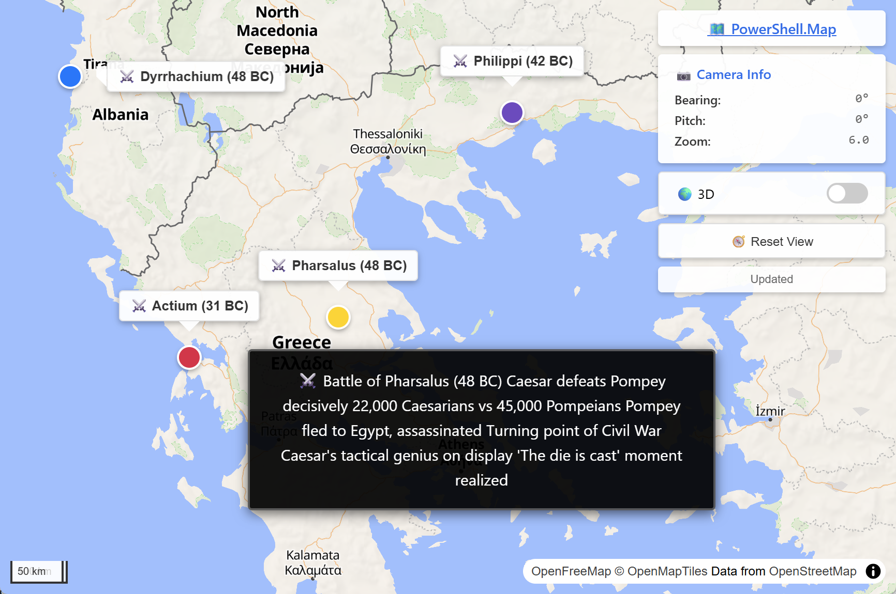
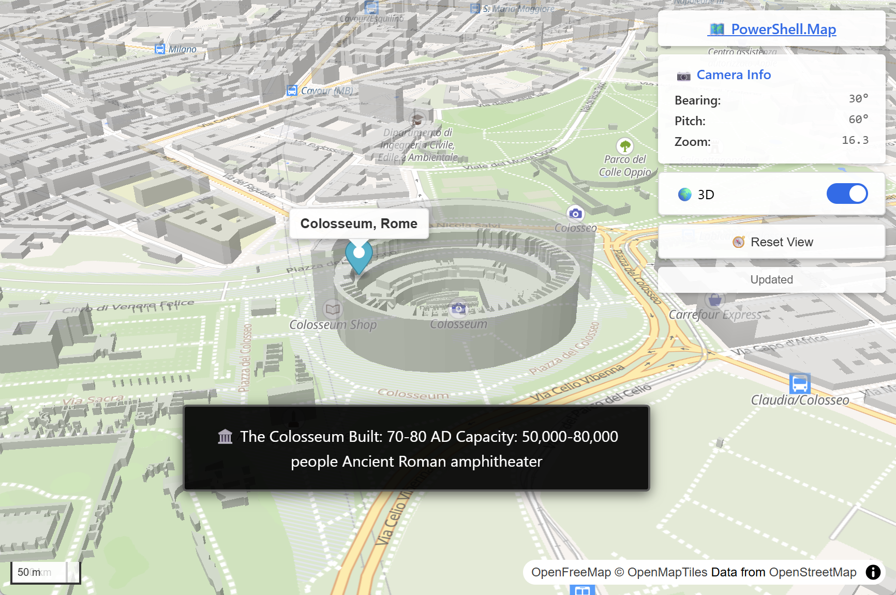

# PowerShell.MCP

[](https://github.com/PowerShell/PowerShell)
[](#prerequisites)
[](https://www.powershellgallery.com/packages/PowerShell.MCP)
[](https://www.powershellgallery.com/packages/PowerShell.MCP)
[](https://opensource.org/licenses/MIT)

**Security Warning:** This module gives AI full PowerShell access to your system. Use it only in trusted environments.

## Overview

*One MCP server that gives AI access to 10,000+ PowerShell modules and any CLI tool — in a console you can see, with you in control.*

The AI works in PowerShell consoles on your desktop. You watch every command as it runs, answer its prompts, type its passwords yourself, and close the window to stop it — without ending the conversation. Give it admin rights when a task needs them and take them back after; point it at other machines and it works on them from the same conversation. A transcript can record all of it ([Auditing an AI Session](SECURITY.md#auditing-an-ai-session)).

<div align="center">
  
</div>

Need bash, cmd, zsh, a language REPL (python, node, …), a SQL console or a debugger instead of PowerShell? See **[ripple](https://github.com/yotsuda/ripple)** — the same shared-console idea for any REPL.

## Why PowerShell.MCP?

Instead of one curated MCP server per service, the AI uses the same modules and CLI tools professionals use:

- **One server replaces many** — [PowerShell Gallery](https://www.powershellgallery.com/) modules (Az, AWS.Tools, Microsoft.Graph, …) and any CLI (git, docker, kubectl, gh, …), learned through `Get-Help`
- **Cross-service pipelines** — describe the result, the AI builds the pipeline
- **Persistent sessions** — authenticate once; modules, variables and functions stay loaded; no startup cost per command
- **Nothing to unlearn** — what the AI runs is ordinary PowerShell: you can rerun it, save it as a script, and learn from it

*"Show me bug issues from the PowerShell repo with their authors"*

```powershell
gh issue list --repo PowerShell/PowerShell --json title,author,labels |
    ConvertFrom-Json |
    Where-Object { $_.labels.name -contains "Issue-Bug" } |
    Select-Object title, @{N='by';E={$_.author.login}}
```

*"List my running Azure VMs with their sizes"*

```powershell
Get-AzVM -Status | Where-Object PowerState -eq "VM running" |
    Select-Object Name, @{N='Size';E={$_.HardwareProfile.VmSize}}, Location
```

## Features

- **🤝 Shared console** — watch every command in real time and answer interactive prompts yourself. On Windows, short AI commands go into the console history.
- **🔒 Secrets stay with you** — `Read-Host -AsSecureString`, `Get-Credential`, MFA codes, `sudo`, `gpg`, `ssh-add` passphrases are typed into the console and never reach the AI. Stdin-piped MCP shells cannot do this.
- **🖥️ Consoles of its own, as many as needed** — each AI session can start several consoles (a long build in one, other work in another) and owns them; parallel sessions never touch each other's (window titles like `#12345 Taxi`, `Get-MCPOwner` shows the owner).
- **📝 File editing in the console** — `Show-TextFiles`, `Add-LinesToFile`, `Update-LinesInFile`, `Update-MatchInFile` and `Remove-LinesFromFile` let the AI read, search and edit text files where you can see each step. They are ordinary cmdlets, for your own use too.
- **🔐 Local by default** — named pipes only; a TCP port opens only while [remote control](#remote-console-another-machine) is on ([SECURITY.md](SECURITY.md#remote-control)).

**Control without ending the conversation** — most useful for auditing and managing network settings:

- **🛡️ Grant and revoke admin rights at any time** — open an Administrator (or root) console for the AI when a task needs it ([how](#admin-work-on-this-machine)); close it and the AI is back to unprivileged consoles.
- **✋ Stop a command the moment you see it** — if one looks dangerous, close the console window: the command dies with it, the conversation goes on, and you can ask the AI what it was trying to do.
- **🌐 Several remote machines in one conversation** — the AI drives up to four [remote consoles](#remote-console-another-machine) directly, side by side, with no new session per machine.

## Defend with AI: network security audits

AI-assisted attacks are no longer aimed only at large companies, and defense is the careful, repetitive checking that gets postponed. **[powershell-mcp-security](https://github.com/yotsuda/powershell-mcp-security)** is a Claude Code plugin that has the AI audit and harden a Windows, Linux or macOS machine — this one, or one reached through [remote control](#remote-console-another-machine) — with you watching:

- **Read-only first**: the settings actually in effect, checked against what is visible from outside.
- **Fixes only with your approval**, in an order that cannot lock you out, verified from outside and again after a reboot.
- **No keys or passwords for the AI**: a person at that machine starts remote control and types `sudo` passwords.

Its read-only helper module **[NetworkSecurityAudit](https://github.com/yotsuda/powershell-mcp-security/tree/main/module/NetworkSecurityAudit)** (`Test-NsaTcpPort`, `Get-NsaListeningPort`, `Find-NsaPermissiveFirewallRule`, …) also works on its own (`Install-Module NetworkSecurityAudit`).

```text
/plugin marketplace add yotsuda/powershell-mcp-plugins
/plugin install powershell-mcp-security@powershell-mcp
```

Then ask: *"Audit the network security of this server. Read-only first, and check what is visible from outside."*

When an audit shows the skill was wrong or incomplete, the AI offers to draft an issue for you to review. Pull requests are welcome ([CONTRIBUTING](https://github.com/yotsuda/powershell-mcp-security/blob/main/CONTRIBUTING.md)).

## Tools

| Tool | Purpose |
|------|---------|
| **This machine** | |
| `start_console` | Reuse a standby console, or launch a new one |
| `get_current_location` | Current directory, drives, and system info |
| `execute_command` | Run any PowerShell command or CLI tool (literal text via `var1`–`var8`) |
| `wait_for_completion` | Wait for busy consoles, local or remote, and collect their output |
| `cancel` | Stop the running command (pipeline stop + Ctrl+C) |
| `close_console` | Kill a console by PID, returning any output it still holds |
| **Another machine** ([Remote console](#remote-console-another-machine)) | |
| `connect_remote_console` | Connect to a listening console with its pairing code |
| `accept_remote_console` | Let a console dial in (behind NAT or a firewall) |
| `execute_remote_command` | Run a command in the remote console |
| `cancel_remote_command` | Send Ctrl+C to the remote console |
| `disconnect_remote_console` | Disconnect one remote console (or stop accepting) |

## Quick Start

### Prerequisites

- PowerShell 7.4+ ([installation guide](https://learn.microsoft.com/powershell/scripting/install/installing-powershell))
- Claude Code, Claude Desktop, or any MCP client
- Windows 10/11 or Server 2016+; Ubuntu 22.04+, Debian 11+, RHEL 8+ (a GUI desktop to see the console); macOS 12+ (Intel or Apple Silicon)

### Install

**1. Install PowerShell 7** — Windows: `winget install Microsoft.PowerShell`; macOS: `brew install --cask powershell`; Linux: see the [installation guide](https://learn.microsoft.com/powershell/scripting/install/install-ubuntu).

**2. In PowerShell 7 (`pwsh`):**

```powershell
Install-PSResource PowerShell.MCP
chmod +x "$(Get-MCPProxyPath)"     # Linux / macOS only

Register-PwshToClaudeCode          # Claude Code
Register-PwshToClaudeDesktop       # Claude Desktop
```

`Register-PwshToClaudeCode` asks whether to disable Claude Code's built-in Bash and PowerShell tools so every command runs in the visible console (recommended; `-DisableBuiltInShellTools` / `-KeepBuiltInShellTools` skip the question). For other clients, put the output of `Get-MCPProxyPath -Escape` in the client's configuration.

**3. Restart your MCP client.**

### Updating

Each version installs into its own folder, so re-register after updating, or commands fail with *"PowerShell.MCP.Proxy version is outdated"*.

1. In a **new** PowerShell 7 window (not a PowerShell.MCP console): `Update-PSResource PowerShell.MCP`
2. In **another new** window (so it loads the new version): run `chmod +x` (Linux/macOS) and `Register-PwshToClaudeCode` / `Register-PwshToClaudeDesktop` again. Existing arguments and environment variables are kept. Other clients: update the path from `Get-MCPProxyPath -Escape`.
3. Close the old console windows (`#12345 Taxi`) and restart your MCP client.

Old versions can be removed with `Uninstall-PSResource PowerShell.MCP -Version <old version>`.

## Configuration

`Register-PwshToClaudeCode` and `Register-PwshToClaudeDesktop` take these options and keep them on later re-registrations. In other clients, add the flag to the `pwsh` entry's `args`.

| Option | Flag | Effect |
|--------|------|--------|
| `-NoProfile` | `--no-profile` | Start consoles without `$PROFILE`: faster, deterministic. `-NoProfile:$false` removes it. (Headless/CI always uses `-NoProfile`.) |
| `-ConsoleLaunch <mode>` | `--console-launch <mode>` | Windows only — how new consoles open (below). `-ConsoleLaunch Auto` removes it. |

```json
"mcpServers": {
  "pwsh": {
    "command": "...PowerShell.MCP.Proxy.exe",
    "args": ["--no-profile", "--console-launch", "minimized"]
  }
}
```

### How consoles open on Windows (`--console-launch`)

- `auto` (default) — a Windows Terminal window opened without activation when Windows Terminal is your default terminal, otherwise a console window. Some systems (seen on Windows 11 build 26200, Windows Terminal 1.24–1.25) activate it anyway, and it always takes focus when a Windows Terminal window is in front.
- `minimized` — a minimized classic console (conhost); never takes focus. Also avoids Windows Terminal pulling windows across virtual desktops.
- `handoff` — the behavior before 1.17.0: Windows decides, focus is taken.

### Idle consoles and multiple sessions

- Each MCP session sees only its own consoles; sessions never share or close each other's. Unowned consoles (one you opened with `Import-Module PowerShell.MCP`, or one whose proxy exited) are claimed by the first session that needs one.
- When consoles pile up, one unused for 10 minutes warns and closes 60 seconds later. Never closed: each session's most recently used console, and a console that is busy, at a prompt, holding uncollected output or typed text, or running a background job. A console you opened yourself, or ran a command in, is never closed.
- A console left behind by an ended session waits 10 minutes to be claimed. The next tool call reports any console that closed or disappeared, and what went with it.

| Variable | Default | Meaning |
|----------|---------|---------|
| `POWERSHELL_MCP_STANDBY_REAP_MINUTES` | `10` | Idle minutes before the warning; `0` disables closing |
| `POWERSHELL_MCP_STANDBY_REAP_GRACE_SECONDS` | `60` | Seconds from warning to close |

Set these as user or system environment variables, not in the MCP client's `env` block: consoles are separate terminal windows and do not inherit the proxy's environment.

### Timeout ceiling

A blocking call waits at most **170 s in Claude Code** and **50 s elsewhere**; past that the command keeps running and its result arrives with the next tool call. If your client waits longer, set `POWERSHELL_MCP_TIMEOUT_CEILING` (seconds, max 170) in the client's `env` block (Claude Code CLI: `claude mcp add -e POWERSHELL_MCP_TIMEOUT_CEILING=120 …`).

## Admin work on this machine

AI-started consoles are not elevated. For admin work:

1. Close all PowerShell.MCP consoles (or ask the AI to close them with `close_console`).
2. Open PowerShell 7 **as Administrator** (Linux / macOS: `sudo pwsh` in a terminal) and run `Import-Module PowerShell.MCP`.

The AI's next command goes to that console (on Windows, its title shows `Administrator:`). The first command stops once to say where the console is, and the AI re-issues it.

## Remote console (another machine)

The AI can drive a console on another machine — a VM, a build box, a colleague's PC — with the person there watching. If that console is elevated, so is the AI: useful for auditing and hardening servers (see [Defend with AI](#defend-with-ai-network-security-audits)).

On the remote machine, in PowerShell 7.4+:

```powershell
Install-Module PowerShell.MCP -RequiredVersion <version>   # once; must match your machine's version
Import-Module PowerShell.MCP
Enable-MCPRemoteControl -AllowFrom 192.168.0.10           # the AI's machine; TCP 42777 (-Port to change)
```

After a confirmation, it prints a one-time pairing code (valid 10 minutes) and its addresses. Tell the AI: *"connect to the remote console at 192.168.0.20 with code 7Q4K-M2XP-H9RT"*. Remote commands behave like local ones (persistent session, `var1`–`var8`, `wait_for_completion`); prompts there show `[AI from <your host>]`. On Linux and macOS a plain SSH session works — no desktop needed.

- **Behind NAT or a firewall:** the AI calls `accept_remote_console` and gives you `Enable-MCPRemoteControl -ConnectTo <your-host>:<port> -Code <code>` to run there. Only outbound is needed there; Windows asks once to allow the proxy through *your* firewall (a local VM's Hyper-V switch usually counts as public).
- **Nothing installable (Windows, no internet):** the AI can give one line to paste into PowerShell 7 or Windows PowerShell. It fetches PowerShell.MCP — and a portable PowerShell 7 if needed — from your machine with hash checks; no admin rights or install required. It can optionally install them for later use, after asking. Needs a shared clipboard.
- **Firewall:** listening mode needs inbound TCP 42777 on the remote machine; the AI can give a scoped `New-NetFirewallRule` line and its removal.
- **Limits:** up to four remote consoles at once, one per machine; with more than one, each call names its console. Dropped connections reconnect. Codes work once; remote control stops after 10 minutes without a connection, or with `Disable-MCPRemoteControl`.
- **Versions:** both machines must run the same PowerShell.MCP version — `Update-Module PowerShell.MCP` (or `Install-Module … -RequiredVersion <v> -Force`) on the older one, then restart the MCP client if it was yours.
- **Security:** TLS with a per-session certificate and a handshake bound to the code; five forged attempts end remote control. Meant for a LAN or VPN, never the open Internet. Details: [SECURITY.md](SECURITY.md#remote-control).

**Granted, not taken.** Remote control starts only when a person at that machine runs `Enable-MCPRemoteControl` (or pastes the line) and confirms; it refuses to start without an interactive console, and stays visible (`[AI from <host>]`, `Administrator:` in the title). **Paste a line only if you asked an AI for it yourself** — "paste this into PowerShell" is how lures start. For a colleague's PC, use listening mode so no line is handed over.

**Remote data can be attacker-written.** Event logs, file contents and web pages may contain text crafted as instructions, read by an AI that also has access to your machine. Pair only with machines you trust that far, ask for read-only work first, and run `Start-Transcript` there to keep a record.

## Try it

- "Open pwsh and show what it can do in a colorful, dynamic, and fun demo"
- "Try out different styles of notifications using the BurntToast module"
- "Automate Notepad: type text and smoothly move the window in a circle"

Two built-in prompts (slash commands in Claude Code; the argument is optional):

- `/pwsh:foreign_language_dictation English, short sentences, normal speed` — reads sentences aloud and checks what you type (Windows only).
- `/pwsh:show_interactive_map major Roman battles in chronological order` — interactive HTML maps with [PowerShell.Map](https://github.com/yotsuda/PowerShell.Map).

<div align="center">
  <table cellspacing="0" cellpadding="0" border="0" width="100%">
    <tr>
      <td align="center" width="45%">
        
        <br/>
        <em>Roman Battle Locations</em>
      </td>
      <td width="3%"></td>
      <td align="center" width="45%">
        
        <br/>
        <em>Colosseum 3D Visualization</em>
      </td>
    </tr>
  </table>
</div>

## Platform notes and limitations

- **Linux:** needs a GUI desktop and a supported terminal (gnome-terminal, konsole, xfce4-terminal, xterm, lxterminal, mate-terminal, terminator, tilix, alacritty, kitty); without one the console runs headless.
- **Linux / macOS:** PSReadLine is replaced by a simpler built-in line editor (PSReadLine blocks the timer that runs AI commands), and AI commands are not added to history. macOS uses Terminal.app.
- **Cancellation:** `cancel` stops pipelines and sends Ctrl+C; a command stuck in a non-interruptible call or at an interactive prompt needs `close_console`.
- **Privacy:** commands you type yourself are not visible to the AI.
- **Colors:** some CLI tools lose color output (git keeps it).
- **Programs that read the console at startup (Windows):** rare (LilyPond is one) — they hang until a key is pressed. Run them as `cmd /d /s /c "<command> < NUL > out.log 2>&1"`. See [docs/Console-Input-Starvation.md](docs/Console-Input-Starvation.md).

## Enterprise deployment (WDAC / Device Guard)

Since v1.7.7, `PowerShell.MCP.dll` and `PowerShell.MCP.Proxy.exe` (win-x64) are Authenticode-signed with the yotsuda code-signing certificate. Certificate, GPO and WDAC instructions: **[github.com/yotsuda/code-signing](https://github.com/yotsuda/code-signing)**; the thumbprint is in each release's notes.

```powershell
Get-AuthenticodeSignature (Get-MCPProxyPath)
```

## Disclaimer

This software is provided "AS IS" without warranty of any kind, either expressed or implied.
The author assumes no responsibility for any damages arising from the use of this software. For enterprise use, ensure compliance with your organization's security policies.

## License

MIT License - see [LICENSE](LICENSE) for details.

## Author

Yoshifumi Tsuda
